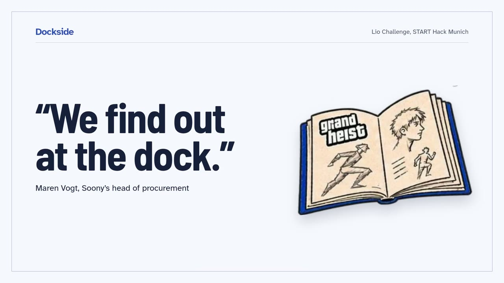
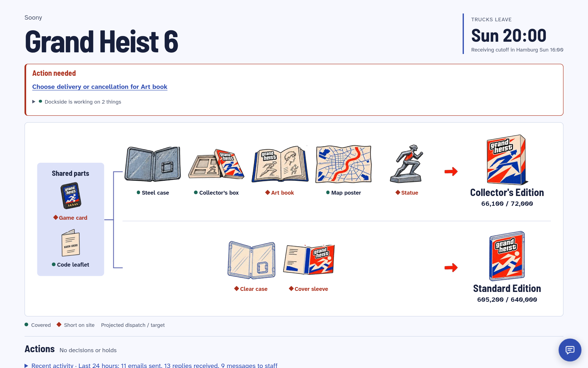
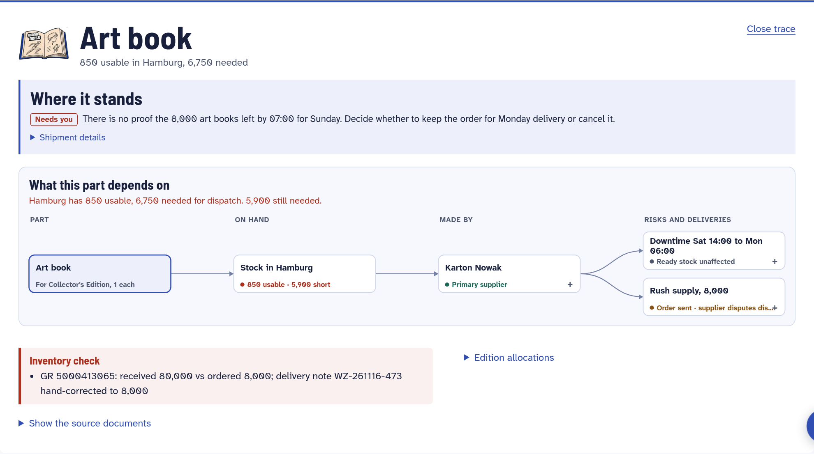
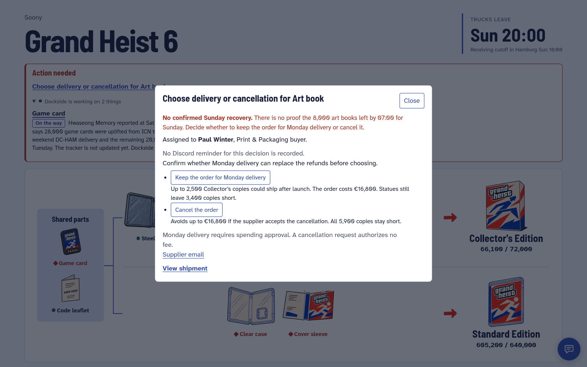

# Dockside

**Dockside monitors inbound freight, forecasts what can ship, and gets decisions to buyers before dispatch.**

Built for the Lio Challenge, *Keep the Line Running*, at START Hack Munich 2026. The demo follows the fictional publisher Soony as it prepares to ship *Grand Heist 6* from Hamburg.

[](https://github.com/EmanuelMedinaAraujo/soony-truck-port/releases/download/hackathon-demo/Dockside-demo.mp4)

**[Demo video (2:54, MP4)](https://github.com/EmanuelMedinaAraujo/soony-truck-port/releases/download/hackathon-demo/Dockside-demo.mp4)** · [Pitch deck (PDF)](https://github.com/EmanuelMedinaAraujo/soony-truck-port/releases/download/hackathon-demo/Dockside-pitch.pdf) · [Stage script and jury Q&A](artifacts/Dockside-stage-script.md)

---

## The problem

> “We find out at the dock.” — Maren Vogt, Soony's head of procurement

Soony's buyers call suppliers every day, and the facts they need are spread across ERP exports, trackers, scanned delivery notes and emails in several languages. In the launch data, one extra zero in a goods receipt (80,000 art books booked instead of 8,000) hid a **5,900-copy shortfall** in the Collector's Edition. At €120 a copy, that is **€708,000 in projected refunds**.

## What Dockside does

Dockside's agents monitor files and inboxes in the background and surface the decisions that need a person.

1. **Watch.** Dockside syncs the supplier portal, reads the shared mailbox, and extracts facts from scans, PDFs and spreadsheets.
2. **Reconcile.** It checks every receipt, shipment and reply against the bill of materials and the packing plan. Then it forecasts how many copies of each edition can actually ship.
3. **Act.** It emails suppliers and carriers in their own language, chases missing confirmations and books follow-ups. It can also rehearse a call with ElevenLabs voice.
4. **Escalate.** Any decision that spends money goes to the person authorized to make it. Dockside offers them the options and what each one costs.



*The home view shows each part of both editions. A red diamond means the part is short on site. Under each edition is the projected dispatch against its target. **Action needed** lists the decisions waiting for a person. **Dockside is working on…** lists what the agents are handling right now.*

Select any part to trace it from stock to supplier to shipment. Dockside shows the source documents that support each claim. For the art book, it caught the 80,000 receipt and checked it against the hand-corrected delivery note:



When a decision needs approval, Dockside gives the buyer the options and their costs. It can also send the decision to Discord and email an approval link. The approval records a digest of the exact terms, so changing a draft requires a new approval:



## Why it matters

- **Value.** If the €16,800 rush order arrives usable and on time, 2,500 additional copies could ship. That could avoid €300,000 in refunds, or €283,200 after the cost of the order.
- **Price.** The proposed €5,000 pilot covers one launch at one site. At Soony's refund rate, 182 additional dispatched copies would cover the pilot and the rush order.
- **Beyond Soony.** The fictional Kestrel Toys replay uses the same engine and a new mapping file for its exports. A verified receipt raises projected Deluxe dispatch from 70 to 100. An independent carrier manifest then flags a conflicting shipment quantity for review.

## How it's built

| Layer | What it does |
| --- | --- |
| `sync/` | Polls the Soony portal, downloads only changed files (by SHA-256) and logs row-level changes |
| `core/ingest.py`, `core/extract_docs.py` | Builds typed records from CSV, XLSX and scanned documents, and extracts facts from PDFs and images with an LLM |
| `core/dispatch.py`, `core/depgraph.py` | Forecasts dispatch from usable stock in edition-priority order, and builds the per-part dependency graph |
| `core/agent.py`, `core/followup.py`, `core/chase*.py` | Runs the planning agent and supplier chaser, and follows up on emails in the supplier's language |
| `core/approvals.py`, `core/release.py` | Handles spending approvals and runs the release gate. Each signature is a SHA-256 digest of the exact terms. Fresh evidence about the carrier, the dock slot and the departure is required |
| `core/voice.py` | Rehearses and places ElevenLabs voice calls |
| `server/app.py`, `server/discord_bot.py` | Serves the FastAPI backend and the Discord bot (`/ask`, `/status`, `/answer`), which share one action log |
| `web/assembly/` | The dashboard: assembly view, trace graph, transport map, actions and chat |

The models are OpenAI `gpt-5.5` for chat, `gpt-5.4-mini` for planning and document extraction, and `gpt-4o-mini-transcribe` for spoken questions. Voice uses ElevenLabs. Every channel (web, phone browser and Discord) reads the same dispatch forecast.

## Run it

```sh
python -m venv .venv && .venv/bin/pip install -r requirements.txt
```

**Offline, no data or keys needed:**

```sh
.venv/bin/python examples/replay_gate.py              # release gate replays the art-book rush order
.venv/bin/python examples/run_customer.py examples/kestrel   # second customer, three file drops
.venv/bin/python -m pytest
```

**Interactive Kestrel replay** using the bundled sample data:

```sh
.venv/bin/python examples/demo_stage.py --mode kestrel --port 8769
```

Open [the Kestrel replay](http://127.0.0.1:8769/demo/kestrel) and use **Load next file drop** to step through the receipt and the carrier manifest.

**Soony stage replay** requires the original challenge stock and action snapshots in `data/`. Chat and microphone questions require `OPENAI_API_KEY`.

```sh
.venv/bin/python examples/demo_stage.py --mode sunday --include-recorded-activity --enable-questions --port 8768
```

Both replays use temporary SQLite databases and disable outbound email, portal polling and Discord delivery.

**Live service.** Copy `.env.example` to `.env` and set `SOONY_TOKEN` and `OPENAI_API_KEY`. Voice, Discord and approval email are optional. See the [operations reference](docs/operations.md) for their configuration and staff access.

```sh
.venv/bin/uvicorn server.app:app --port 8765 --env-file .env
```

Open [the local dashboard](http://127.0.0.1:8765/). Policy, people and approval rules are in `config/business.json`.

## More

- [docs/operations.md](docs/operations.md): supplier chaser, voice calls, spending approvals, release gate and onboarding a new customer, in full detail
- [docs/findings.md](docs/findings.md): what we found in Soony's data, including contradictions, critical shipments and data traps
- [docs/strategy.md](docs/strategy.md) and [docs/design.md](docs/design.md): the pitch strategy and the product design

The repository includes synthetic Kestrel fixtures. The challenge snapshots and local credentials are ignored by Git. The dashboard uses artwork from Lio's challenge materials and map coastlines from [Natural Earth](https://www.naturalearthdata.com/downloads/110m-physical-vectors/110m-land/).
